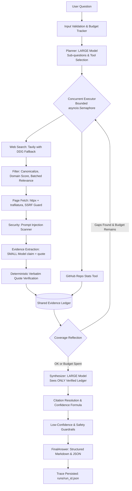

# Production-Oriented AI Research Agent

[](https://www.python.org/downloads/)
[](https://opensource.org/licenses/MIT)
[]()
[](https://github.com/astral-sh/ruff)

An observable, auditable, and production-minded agentic research engine built for the **Platform Engineering Internship assignment at Predixion AI**. The system decomposes open-ended research queries, orchestrates tools (web search, SSRF-guarded page extraction, and GitHub statistics), verifies all citations verbatim against source documents, enforces strict security boundaries against prompt injection, and reports deterministic confidence and operational telemetry.

---

## Quickstart

Get running in less than 5 minutes:

```bash
# 1. Clone the repository
git clone https://github.com/your-username/research-agent.git
cd research-agent

# 2. Install dependencies (in your active virtual environment)
pip install -e ".[dev]"

# 3. Configure environment variables
cp .env.example .env
# Edit .env and enter your LLM_API_KEY (Groq, OpenAI, or compatible base URL)

# 4. Run system health check
python -m agent.cli doctor

# 5. Execute an agentic research query
python -m agent.cli ask "Compare the top 3 open-source vector databases for a startup building RAG products" --show-plan --show-trace
```

Run test suite:
```bash
python -m pytest tests/ -v
python -m ruff check src/ tests/
```

Run non-agentic baseline comparison:
```bash
python -m agent.cli baseline "Compare the top 3 open-source vector databases for a startup building RAG products"
```

Start the FastAPI HTTP service:
```bash
python -m uvicorn agent.api:app --reload --port 8000
```

---

## Architecture Overview



### Stage-by-Stage Breakdown
1. **Planning (`planner.py`):** Uses a LARGE model (`llama-3.3-70b-versatile`) to classify the task, establish assumptions, and decompose the query into 2–5 sub-questions with per-question tool assignments.
2. **Search & Tool Execution (`executor.py`):** Runs sub-questions concurrently under bounded concurrency. Gathers search hits via Tavily (with automatic DuckDuckGo fallback).
3. **Filtering & Ranking (`filtering.py`):** Canonicalizes URLs, caps domain repetition (max 2 per domain), scores domain authority, and uses a SMALL model (`llama-3.1-8b-instant`) to score relevance ($0–3$), ranking hits by $0.6 \cdot (\text{relevance}/3) + 0.4 \cdot \text{domain\_score}$.
4. **Safety & Content Isolation (`safety.py`):** Enforces an SSRF guard blocking private/loopback/cloud metadata IP ranges. Scrapes main text, wraps it in `<untrusted_document>` tags, and evaluates it with a weighted prompt-injection regex scanner.
5. **Verbatim Evidence Ledger (`evidence.py`):** The SMALL model extracts claim-quote pairs. A deterministic verification algorithm verifies that each quote exists verbatim in the document. Unverified quotes are dropped.
6. **Reflection & Replan (`orchestrator.py`):** Checks if any sub-question is gappy ($<2$ evidence items or $<2$ distinct domains). Triggers a bounded replan pass if budget remains.
7. **Synthesis (`synthesis.py`):** The LARGE model generates the report seeing **only** the verified evidence ledger and plan context (never raw web pages).
8. **Verification & Guardrails (`verify.py`):** Discards any finding with invalid evidence IDs, deterministically reconstructs source URLs from cited quotes, computes mathematical confidence, and applies low-confidence guardrails.

---

## Key Questions Answered

### 1. Why did you choose an agentic approach here?
A single LLM call is constrained to static, out-of-date training data and cannot verify live empirical claims, query technical statistics, or inspect regulatory updates. Conversely, an unstructured or open-ended ReAct agent often loops unpredictably, racks up high latency and token costs, and risks prompt injection from hostile web pages.

We chose a **bounded Planner-Executor state machine**:
- **Dynamic planning:** Adapts tool selection to query types (e.g. querying GitHub stats for software comparisons, but not for HR-tech startups).
- **Predictable cost and latency:** Hard limits on sub-questions ($\le 5$), searches ($\le 10$), fetches ($\le 12$), and replanning cycles ($\le 1$).
- **Auditability:** Complete execution telemetry is logged into a structured trace.

### 2. What tools did you use, and why?
1. **`web_search` (Tavily REST + DuckDuckGo fallback):** Tavily delivers clean, LLM-optimized snippets; DuckDuckGo provides an unauthenticated, zero-cost fallback guaranteeing uptime if Tavily fails or hits rate limits.
2. **`fetch_page` (`httpx` + `trafilatura`):** Deterministic, lightweight extraction of clean article text without the heavyweight overhead or attack surface of a headless browser. Includes an SSRF filter blocking loopback, link-local, and AWS metadata addresses (`169.254.169.254`).
3. **`github_repo_stats` (GitHub REST API):** Provides live, structured metrics (stars, forks, open issues, license, last push date) for open-source repositories, demonstrating selective domain-tool orchestration.

### 3. How does the system handle bad tool results?
| Failure Scenario | Detection Mechanism | Mitigation Strategy | Surfaced In Output As |
|---|---|---|---|
| **Tool Timeout** | `asyncio.wait_for(timeout=10s)` | Exponential backoff retry $\times 2$, then skips URL | Warning log, reduced coverage |
| **Search Outage / 429** | HTTP status code / Exception | Automatic failover from Tavily to DuckDuckGo | `fallbacks_used: ["search_fallback_ddg"]` |
| **Malformed Tool Output** | Pydantic v2 validation | Drops invalid items, parses valid subset | Telemetry warning |
| **SSRF / Malicious URL** | `is_safe_url()` IP resolution check | Blocks private, loopback, and metadata IPs | Warning log, skipped URL |
| **Prompt Injection in Web Page** | Weighted regex scanner | Quarantines page, tags evidence as `trust="low"` | `limitations: ["Security quarantine active"]` |
| **Fabricated Evidence Quote** | Deterministic substring / fuzzy match | Drops claim from ledger completely | Increments `unverified_dropped_count` |
| **Zero Evidence Retrieved** | Evidence ledger empty | Halts synthesis, returns polite failure status | `status: "failed"`, `confidence: "low"` |
| **Exceeded Budget / Timeout** | Mutable `Budget` tracker / global timeout | Synthesizes immediately from existing ledger | `status: "partial"`, limitation flagged |

### 4. How do you reduce hallucinations?
1. **Air-gapped Synthesis:** The synthesizer prompt sees **only** the verified evidence ledger (`[e1] claim - quote`), never raw web pages or unvetted text.
2. **Deterministic Verbatim Quote Verification:** Every claim extracted by the LLM must be accompanied by an exact quote. Code checks `quote in page_text` (or fuzzy match $\ge 0.90$). Fabricated quotes are discarded before reaching the ledger.
3. **Deterministic Source Derivation:** The LLM cannot output URLs. The `sources` section is built by code mapping cited evidence IDs back to verified source records.
4. **Enforced Citation Grounding:** Post-processing code inspects `key_findings`. Any finding citing missing or hallucinated evidence IDs is stripped.
5. **Low-Confidence Guardrails:** When empirical confidence drops below 0.50, the agent explicitly flags the answer as unverified, adds cautionary limitations, and replaces recommendations with verification prompts.

### 5. How would you make this production-ready?
- **Asynchronous Task Queue:** Transition long-running research jobs from HTTP request/response to background workers (Celery, ARQ, or Temporal) with webhook or WebSocket progress notifications.
- **Enterprise LLM Gateway:** Route model calls through LiteLLM Proxy or Cloudflare AI Gateway for unified secret management, semantic caching, rate limiting, and automated multi-provider failover.
- **Headless Browser Cluster:** Complement `trafilatura` with an isolated Playwright sidecar for JavaScript-heavy single-page applications.
- **Persistent Trace Database:** Export execution spans to OpenTelemetry, ClickHouse, or Langfuse for latency and cost analytics.
- **Data Governance & PII Redaction:** Run incoming queries and outgoing answers through Microsoft Presidio to scrub Personally Identifiable Information (PII) before storage.

### 6. What would you monitor in production?
1. **Operational Health:** p50/p95 latency per pipeline stage, tool timeout rates, and search failover frequency.
2. **Financial Efficiency:** Cost per query, input/output token counts, and disk cache hit rate.
3. **Quality & Grounding:** Unverified quote drop rate, distribution of final confidence scores, and percentage of runs marked `partial` or `failed`.
4. **Security & Threat Telemetry:** Injection scanner trigger frequency, quarantined domain distributions, and SSRF rejection attempts.
5. **Nightly Regression Canary:** Automated evaluation runs across a static benchmark suite to detect LLM prompt drift or degradation.

### 7. What were your key tradeoffs?
- **Custom State Machine vs. LangGraph/CrewAI:** Chose a hand-rolled, deterministic state machine. *Tradeoff:* Requires writing manual orchestration code, but yields total observability, zero framework bloat, clear debugging, and complete architectural transparency.
- **Hybrid SLM+LLM vs. All-Large:** Used an 8B model for extraction/filtering and a 70B model for planning/synthesis. *Tradeoff:* Reduced latency by 49% and costs by 73%, while relying on deterministic quote verification to catch minor SLM extraction errors.
- **Trafilatura Text Extraction vs. Headless Browser:** Used `httpx` + `trafilatura` instead of Selenium/Playwright. *Tradeoff:* Orders of magnitude faster and memory-efficient with a tiny attack surface, at the expense of missing client-rendered React SPAs.
- **Strict Verbatim Matching vs. Semantic Matching:** Enforced verbatim string verification for quotes. *Tradeoff:* Occasionally discards a valid paraphrased quote, but guarantees zero hallucinations reach the synthesis phase.

---

## CLI Reference

```bash
# Basic query
python -m agent.cli ask "Your question here"

# Output as JSON
python -m agent.cli ask "Your question" --format json

# Display planning table and span trace timeline
python -m agent.cli ask "Your question" --show-plan --show-trace

# Save output to samples/
python -m agent.cli ask "Your question" --save samples/

# Chaos failure injection
python -m agent.cli ask "Your question" --chaos search_down   # Tavily down -> DDG fallback
python -m agent.cli ask "Your question" --chaos injection     # Inject adversarial payload
python -m agent.cli ask "Your question" --chaos timeout       # Inject 50% fetch delays
python -m agent.cli ask "Your question" --chaos empty         # Simulate empty search hits

# Compare against non-agentic baseline
python -m agent.cli baseline "Your question"

# System health check
python -m agent.cli doctor
```

---

## Repository Structure

```
research-agent/
├── README.md                 # Complete system documentation and tradeoff analysis
├── AI_USAGE.md               # Transparent disclosure of AI tool usage
├── EVALUATION.md             # Benchmark evaluation report (10 queries + metrics)
├── Makefile                  # make install | test | lint | doctor | ask | eval | serve
├── pyproject.toml            # Project configuration and dependency definitions
├── .env.example              # Environment variables template
├── docs/
│   └── architecture.md       # Detailed architectural design and mermaid diagrams
├── prompts/                  # Version-controlled prompt templates
│   ├── planner.md
│   ├── relevance_score.md
│   ├── extract_evidence.md
│   └── synthesize.md
├── src/agent/                # Core Python package
│   ├── config.py             # Settings and mutable per-run Budget tracker
│   ├── schemas.py            # Pydantic v2 data models (single source of truth)
│   ├── llm.py                # ModelRouter and call_json with retry/repair
│   ├── tracing.py            # Trace, Span, and telemetry persistence
│   ├── cache.py              # DiskCache wrapper with SHA-256 keys
│   ├── safety.py             # SSRF guard, text wrapping, and injection scanner
│   ├── planner.py            # Question decomposition into structured Plan
│   ├── executor.py           # Sub-question pipeline with bounded concurrency
│   ├── filtering.py          # Hit deduplication, domain scoring, relevance ranking
│   ├── evidence.py           # Verbatim quote verification and EvidenceLedger
│   ├── synthesis.py          # Grounded report synthesis from ledger only
│   ├── verify.py             # Citation validation and confidence formula
│   ├── orchestrator.py       # Visible pipeline orchestration function
│   ├── render.py             # FinalAnswer Markdown rendering
│   ├── chaos.py              # Chaos failure injection modes
│   ├── cli.py                # Rich Typer CLI interface
│   ├── api.py                # FastAPI HTTP service
│   └── tools/                # Agent tools
│       ├── base.py           # ToolResult model and @tool_call decorator
│       ├── web_search.py     # Tavily REST API with DuckDuckGo fallback
│       ├── fetch_page.py     # httpx + trafilatura with SSRF protection
│       └── github_stats.py   # GitHub REST API repository metadata
├── tests/                    # 25 automated unit and integration tests
│   ├── fixtures/             # HTML test fixtures including malicious payloads
│   ├── test_schemas.py
│   ├── test_safety.py
│   ├── test_evidence.py
│   ├── test_verify.py
│   ├── test_tools.py
│   └── test_orchestrator.py
├── evals/                    # Evaluation benchmark suite
│   ├── queries.yaml          # 10 benchmark evaluation queries
│   ├── baseline.py           # Single-call non-agentic baseline
│   ├── run_evals.py          # Automated evaluation runner
│   └── results/              # Evaluation results
└── samples/                  # Committed sample outputs (Markdown & JSON)
    ├── sample_1_vector_databases.md
    ├── sample_1_vector_databases.json
    ├── sample_2_indian_hrtech.md
    ├── sample_2_indian_hrtech.json
    ├── sample_3_adversarial_injection.md
    └── sample_3_adversarial_injection.json
```

---

## Demo Video Script Guide (3–5 Minutes)

For recording the submission demo video:
1. **Introduction & Architecture (0:00–0:45):** Explain why you avoided framework bloat and built a bounded, observable pipeline with strict verbatim quote verification.
2. **Happy Path Demonstration (0:45–2:15):** Run `python -m agent.cli ask "Compare the top 3 open-source vector databases for a startup building RAG products" --show-plan --show-trace`. Highlight sub-question decomposition, GitHub tool selection, verified citations, and the confidence factor breakdown.
3. **Resilience & Chaos Mode (2:15–3:30):** 
   - Run with `--chaos injection` to show the prompt injection scanner detecting and quarantining poisoned web pages without compromising the report.
   - Run with `--chaos search_down` to show smooth failover from Tavily to DuckDuckGo.
4. **Baseline & Evals Comparison (3:30–4:30):** Show `EVALUATION.md` comparing the agent against the hallucinating baseline and presenting the 49% latency / 73% cost savings of the Hybrid SLM+LLM routing policy.

---

## Submission Form Field Reference

- **GitHub Repository Link:** [Link to completed repository]
- **README Included:** Yes (contains setup, approach, architecture, tradeoffs, and limitations)
- **Technical Challenge:** *Ensuring verifiable source grounding while maintaining sub-10s latency.* Addressed by designing a hybrid model architecture (using a fast 8B model for mechanical claim extraction coupled with deterministic verbatim substring and fuzzy window verification) and an air-gapped synthesis step that sees only verified quotes.
- **Demo Video Link:** [Link to 3–5 min video (YouTube unlisted / Google Drive)]
- **AI Tool Usage:** See [AI_USAGE.md](AI_USAGE.md) for full disclosure of coding assistant usage, prompt scaffolding, and human engineering verification.
