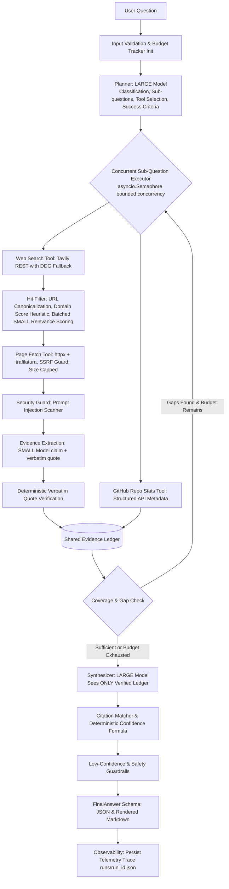

# System Architecture: Predixion AI Production-Oriented Research Agent

This document details the architectural design, lifecycle, and component interactions of the production-oriented AI research agent built for the Platform Engineering Internship assignment at Predixion AI.

---

## 1. High-Level Pipeline Diagram

---

## 2. Architectural Principles

1. **Deterministic Containment over Agentic Chaos:**
   The LLM is invoked strictly where semantic reasoning or judgment is needed (planning, relevance filtering, claim extraction, and final synthesis). Orchestration, timeouts, retries, URL verification, quote verification, citation resolution, and confidence scoring are deterministic Python code.

2. **Zero-Trust for Web Content (Untrusted Boundary):**
   Every web document retrieved is treated as hostile untrusted data. It is wrapped inside `<untrusted_document>` tags, scanned for prompt injection attacks using weighted regex heuristics, and quarantined if suspicious. The synthesis model never sees raw web HTML or unextracted text.

3. **Verbatim Quote Grounding (Eliminating Hallucinations):**
   The LLM cannot invent citations. For every extracted claim, a verbatim quote must be extracted from the source document. A deterministic substring and fuzzy matching algorithm verifies the quote against the raw text. Unverified quotes are dropped before reaching the Evidence Ledger.

4. **Hierarchical Model Routing (Hybrid SLM + LLM):**
   High-volume, mechanical tasks (relevance scoring, evidence extraction, query expansion) use a fast, cost-efficient Small Language Model (`llama-3.1-8b-instant`). Reasoning-intensive steps (planning, synthesis, judgment) use a capable Large Language Model (`llama-3.3-70b-versatile`).

---

## 3. End-to-End Pipeline Stages

### Stage 1: Validation & Budget Tracker
- Sanitizes the user query (length bounds 5–1000 characters).
- Instantiates a mutable, per-run `Budget` tracker from environment configuration (`Settings`).
- Enforces hard budget ceilings: `MAX_SEARCH_CALLS`, `MAX_FETCHES`, `MAX_LLM_CALLS`, `MAX_REPLANS`, and a global `RUN_TIMEOUT_S`.

### Stage 2: Planning & Decomposition
- The LARGE model produces a Pydantic-validated `Plan` containing:
  - `task_type`: (`comparison`, `list_and_summarize`, `pros_cons`, `survey`, `other`)
  - `interpretation`: The agent's restated understanding of the request
  - `assumptions`: Explicit premises (e.g. "assessing vector databases by GitHub adoption and latency")
  - `sub_questions`: 2 to 5 targeted sub-questions with per-question tool assignments
  - `success_criteria`: Concrete requirements for completeness

### Stage 3: Tool Execution & Retrieval
- Sub-questions are executed concurrently under an `asyncio.Semaphore(3)` to respect provider rate limits.
- **Search:** Queries are sent to Tavily REST API; if Tavily fails, times out, or rate-limits, the tool falls back automatically to DuckDuckGo (`ddgs`).
- **Filtering:** 
  1. Canonicalizes URLs and deduplicates hits.
  2. Caps results to a maximum of 2 hits per domain.
  3. Computes a deterministic `domain_score` (boosting official docs, GitHub, educational/government domains; penalizing SEO farms and listicles).
  4. Batches search hits into a single SMALL model call to rate relevance from 0 to 3.
  5. Ranks by `0.6 * (relevance / 3) + 0.4 * domain_score`, retaining the top 4 hits.

### Stage 4: Page Fetching & Safety Isolation
- `is_safe_url()` guards against SSRF by rejecting non-HTTP schemes, embedded credentials, and resolving hostnames against IPv4/IPv6 private and cloud metadata address blocks (`127.0.0.0/8`, `10.0.0.0/8`, `169.254.169.254`, etc.).
- Content is fetched with `httpx.AsyncClient` up to a byte limit (`FETCH_MAX_BYTES`), parsed into text with `trafilatura`.
- `scan_untrusted()` evaluates text against injection patterns. Flagged pages receive `trust="low"`, and pages with high injection scores ($\ge 0.7$) are quarantined.

### Stage 5: Verbatim Evidence Ledger
- For each fetched page, a SMALL model extracts claim-quote pairs.
- `verify_quote_verbatim()` deterministically searches the raw page text for the exact quote. If exact matching fails, a high-threshold fuzzy window ($\ge 0.90$) checks for minor whitespace or punctuation differences.
- If verified, the evidence is entered into the `EvidenceLedger` under a unique key (`e1`, `e2`, ...). If unverified, it is dropped and the dropped counter increments.
- If the plan specified GitHub stats, `github_repo_stats` queries GitHub's REST API and injects structured adoption evidence.

### Stage 6: Reflection & Coverage Check
- Evaluates evidence coverage across all sub-questions.
- If any sub-question has $<2$ evidence items or $<2$ distinct source domains, and the replan budget allows, a bounded replan pass is triggered to fill the gap.

### Stage 7: Synthesis
- The LARGE model receives **only** the plan context and the verified `EvidenceLedger` strings (`[e1] claim - quote`).
- System prompt instructs the model to state "insufficient evidence" rather than guessing, and to cite evidence IDs for every single statement.

### Stage 8: Verification & Guardrails
- Validates every cited evidence ID against the ledger. Any unbacked findings are stripped.
- Reconstructs the `sources` list deterministically from cited evidence URLs (the LLM cannot fabricate sources).
- Evaluates the mathematical confidence formula:
  $$\text{Score} = 0.30 \cdot Q_{\text{source}} + 0.25 \cdot C_{\text{coverage}} + 0.20 \cdot V_{\text{quote}} + 0.15 \cdot A_{\text{consistency}} + 0.10 \cdot F_{\text{freshness}} - \text{Penalties}$$
- If confidence is "low", the low-confidence guardrail prefixes the short answer with a warning caveat, notes thin evidence in limitations, and adjusts next steps.
- The complete telemetry trace is saved to `runs/{run_id}.json`.
